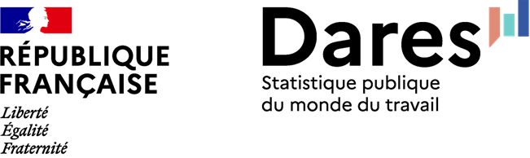

# Inscription

👉️ Les inscriptions se font [ici](https://grist.numerique.gouv.fr/o/ssphub/forms/qvuQ97GVzgwHi3c7RRmhh5/55). 👈️ Possibilité de participer en présentiel et en ligne.

# Agenda

L’agenda de la journée est le suivant :

- **9h15-9h45**: **Accueil**, moment de convivialité autour d’un café.
- **9h45-12h45**: **Retours d’expérience**
  - 9h45 - 10h30 : Générer de la donnée synthétique textuelle pour la codification automatique ([repo ](https://github.com/mateomorin/Code2Text-presentation) et [site](https://mateomorin.github.io/Code2Text-presentation/)) - Insee (SSPLab) ;
  - 10h30 - 11h15 : De l’idée au service public : plongée dans [“Qu’en dit la Cour?”](https://www.ccomptes.fr/fr/actualites/quen-dit-la-cour-une-nouvelle-porte-dentree-vers-nos-travaux) - Cour des comptes
  - 11h45 - 12h : Pause
  - 12h - 12h45 : L’IA, un bon correcteur de dictées ? ([repo ](https://github.com/InseeFrLab/evaluation_dictee)) - SSM Education nationale (DEPP) et Insee (SSPLab)
- **12h45-14h**: **Pause déjeuner**
- **14h - 15h45 : session sur le *vibecoding***
  - 14h - 14h30 : benchmark sur les tools et opencode sur SSPCloud - Insee (SSPLab)
  - 14h30 - 15h30 : atelier de partage
- **15h30 - 16h15 : ComparIA (PEReN)**
- **16h15 - 16h45 : Pause**
- **16h45 - 17h30 : Retour d’expérience** : Le data engineer en conditions réelles : dompter un pipeline de production statistique - Insee (DERA)
- **17h30-19h30**: **Pot**, moment de convivialité

# Replay et présentations

# Contact

Pour toute information : <ssphub-contact@insee.fr>

# Autres événements du réseau

##### Journées data science & *open-source*

Programme et modalités d’inscription aux journées de contribution à l’open source en lien avec la data science

##### Génération de commentaire de graphiques : retour d’expérience sur les statistiques agricoles et pistes d’amélioration

Le **14 avril (14h00 - 14h30)**, le SSM Agriculture vient présenter leur travail pour générer des commentaires de graphiques automatiquement.

##### Analyse textuelle de documents longs : cas des accords d’entreprise

Le **18 mars (14h00 - 15h30)**, la DARES a présenté leur travail sur les conventions collectives ou accords d’entreprise.

##### Françoise Bahoken et Nicolas Lambert, présentation de leur livre Cartographia

Le **13 janvier (14h30 - 15h30)**, Françoise Bahoken et Nicolas Lambert nous ont présenté leur dernier livre…

##### Troisième journée du SSPHub

Programme et modalités d’inscription à la 3e journée du réseau

##### Atelier - Comment récupérer des données sous format Parquet ?

Le format `Parquet` est un format de données connaissant une popularité importante du fait de ses caractéristiques techniques (orientation colonne, compression…
